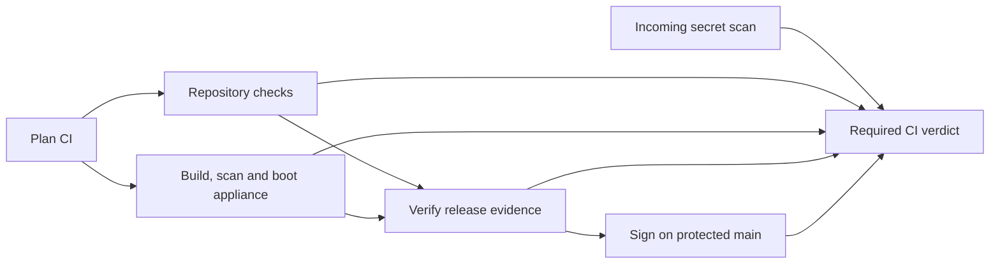

<!-- SPDX-License-Identifier: Apache-2.0 -->
# Maintaining CI

Pull requests, merge groups and pushes to `main` use `.github/workflows/ci.yml`.
For routine changes, open a PR, inspect **Required CI verdict** and CodeQL,
review the change, and use GitHub's existing merge queue. There is no pilot mode
to choose and no separate closure-transfer workflow to operate.

The seven jobs include the reusable incoming secret scan. Repository checks run
one complete `nix flake check`, formatting and all twenty recorded obligations;
the same runner binds the completed audit to the evaluated candidate. Build,
installer assembly, inventory generation, fresh scanning and boot verification
share a second runner and Nix store. They run sequentially and stop on failure.
Independent audit and product work can run in parallel after planning.

Local manifests still verify derivations, output paths, NAR hashes, native index
bytes, graph digest and workflow attempt. They do not export appliance/installer
closures just to import them into another runner. The final protected-main
security report retains its authenticated distribution transport for existing
publication and installer consumers. Artifact names, qualification-state schema
and version 2 signed result remain compatible with those readers.

The historical decision-only shortcut and migration equivalence job no longer
run in CI. A retained decision cannot skip current qualification, native scans,
boot proof or the complete audit. The migration equivalence command remains an
explicit developer diagnostic; the product, runtime-security VM, policy and
configuration assertions remain ordinary flake checks. This retires the
migration experiment's extra base/candidate evaluations and mutation runs; it
does not claim that those experiments still execute automatically.

Authenticated reuse of unchanged installer media or inventories remains a
routing optimization. Every selected path still scans fresh databases and
verifies executed or authenticated retained boot evidence. Force a fresh build
with **CI → Run workflow → force_artifact**. `validate_only` is an explicit
manual check-only run; it cannot sign or qualify a release. `release_candidate`
is reserved for the existing release dispatcher. Ordinary PRs cannot choose a
check-only route. Use **Re-run all jobs** after an interrupted attempt: evidence
from another attempt cannot be spliced into the current run.

Signing runs separately, only after successful audit, qualification and native
evidence verification on protected main. Build jobs have read-only permissions
and no App or publication secrets. The required verdict rejects missing, failed,
cancelled or unexpectedly skipped work. The existing review authority, CodeQL,
Gitleaks, merge queue, findings approval and publication controls are unchanged.
CI validation does not publish a release or accept security findings.

## Other workflows

| Workflow | When to use it |
| --- | --- |
| CodeQL Advanced | Automatic source analysis; required checks stay separate from appliance builds. |
| Scan repository secrets | Called by incoming CI; scheduled full-history scan remains independent. |
| Security maintenance | Daily advisory refresh and policy drift; manual exact-product refresh when needed. |
| Refresh flake inputs | One weekly PR for both lockfiles; Dependabot groups action and Cargo updates. |
| Publish Maestro / Release Maestro | Existing cache/release preparation and protected findings review. |
| Consumer probe | Verify published artifacts from the consumer's perspective. |
| Decision event/authority/health workflows | Existing protected review authority; metadata signals never execute PR code. |
| CI admission / Queue automation | Compatibility recovery for existing App/queue policy; they do not replace human review. |
| Decision packet inspection | Manual historical recovery, outside ordinary development. |

These authority/recovery workflows remain because live rules and consumers
still depend on them. Removing their required check without migrating those
contracts would strand PRs or weaken publication controls. They are not extra
appliance validation passes. The earlier authority-cutover designs are historical
proposals, not instructions for normal CI operation.

The queue path is bounded at 315 minutes, leaving 45 minutes inside the existing
360-minute response budget. The consolidated build job has a 225-minute queue
limit and a 360-minute nonqueue limit. Evidence verification and the final
verdict each allow 30 minutes: the first cold evidence runner needed about 21 minutes, mostly before its 13-second native
verification task. These are caps, not a speedup benchmark;
observe hosted resource/disk use and cold-build duration before claiming a
speedup. Full Nix/VM/ISO validation runs in hosted CI, not on the bounded local
fixture runner.

The structure follows GitHub's guidance on [merge-group checks](https://docs.github.com/en/pull-requests/how-tos/merge-and-close-pull-requests/troubleshooting-required-status-checks)
and [credential boundaries](https://docs.github.com/en/actions/reference/security/secure-use).
