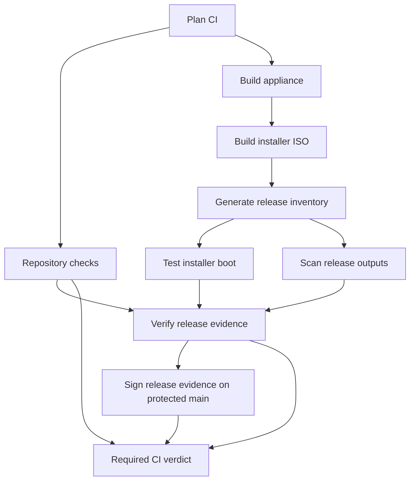

# Feature navigation

Maestro has one appliance, `nixosConfigurations.maestro`, composed explicitly by
`modules/features/appliance/composition.nix`. Flake-parts owns outputs; Den owns
NixOS and Home Manager aspect values. One import-tree discovers ordinary module
files. `_source/`, `_tests/` and `_lib/` are private and never auto-imported.

| Where to change… | Owner |
| --- | --- |
| Appliance composition or host wiring | `modules/features/appliance/` |
| Durable operator policy | `host/settings.nix` |
| Disks and filesystems | `host/hardware-configuration.nix` |
| Generated console overrides | `host/menu.nix` |
| Boot, networkd, DBus switching or Nix GC | `modules/features/platform/` |
| Operator options, SSH or management networks | `modules/features/operator/account.nix`, `access.nix` |
| CLI behavior | `modules/features/operator/cli/_source/` |
| Ratatui frontend or console backend | `modules/features/operator/menu/_source/` |
| XO service, storage privilege or TLS | `modules/features/xo/` |
| Bounded file restore | `modules/features/xo/file-restore/` |
| ISO or installation behavior | `modules/features/installer/` |
| Guest integration or native Packer template | `modules/features/xcp-ng/` |
| Native development tools and tasks | `modules/features/development/` |
| CI graph and target registration schema | `modules/ci/graph/` and each owner's `ci.nix` |
| Repository-wide contracts | `modules/ci/checks/` |
| Native inventory and scanning | `modules/ci/inventory/`, `modules/ci/security/` |
| Live decision authority and historical receipt readers | `modules/ci/authority/` |
| Publication contracts | `modules/release/publication/` |
| Inputs, follows, caches and generation | `modules/flake/` |

[Generated output ownership](feature-outputs.md) covers every existing audit,
media, evidence and publication target. `lib.ciPlans.x86_64-linux` is generated
from typed feature registrations. The committed graph plan data preserves
existing native readers and is checked against those registrations. Regenerate
`flake.nix` with `nix run .#write-flake`; `check-flake-file` verifies it in CI.
Inspect evaluated graph JSON with:

```bash
nix eval --json .#lib.ciGraph.x86_64-linux
nix run .#maestro-ci-graph -- candidate.json
nix run .#maestro-ci-graph -- candidate.json --ownership
```

CI evaluates immutable candidate/base source archives for PR, merge queue and
main events. Unknown graph versions, absent base graphs and unmapped inputs
require complete validation. Ordinary CI resolves evaluated qualification identities
even for documentation-only changes; changed-path hints cannot authorize a skip.
The explicit validation-only dispatch remains available. Target equality describes potential deterministic
cache reuse; authenticated producer bindings, verifier/policy identity, current
databases and live review authority remain separate obligations.



The existing verified retained-evidence path remains separate and keeps its
fork restrictions and force-build controls. Every cross-job transfer binds an
immutable workflow attempt, graph digest, derivations, output paths and NAR
hashes to the producer job's manifest digest. Consumers restore those exact
bytes through the existing bounded closure transport; transfer verification
never silently builds replacements. Boot results distinguish `executed` from
`verified-retained`. Inventory covers installer boot content and distributed
tools as well as the appliance. Scan freshness and live publication authority
retain their existing native verifiers.

The route plan and qualification artifacts retain their existing schemas and
readers. The additional graph plan and `ci-result.json` use schema version 1;
protected-main signing also attests the complete graph result. The required
check remains **Required CI verdict**, alongside separate CodeQL and review
requirements.

Graph scheduling is **disabled**. Hosted complete validation, mutation/equivalence
checks and same-candidate comparisons must pass before any future enablement.
See [migration evidence](maestroden-evidence.md) for raw run links and remaining
comparison status. No speedup is assumed from the new job boundaries.
