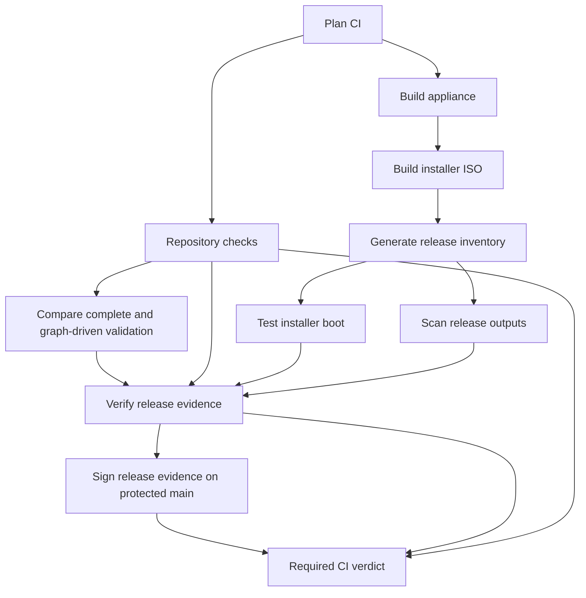

# Feature navigation

Maestro has one appliance, `nixosConfigurations.maestro`, composed explicitly by
`modules/features/appliance/composition.nix`. Flake-parts owns outputs; Den owns
NixOS and Home Manager aspect values. One import-tree discovers ordinary module
files. `_source/`, `_tests/` and `_lib/` are private and never auto-imported.

| Where to change… | Owner |
| --- | --- |
| Appliance composition or host wiring | `modules/features/appliance/` |
| Durable operator policy | `host/settings.nix` |
| Disks and filesystems | `host/hardware-configuration.nix` |
| Generated console overrides | `host/menu.nix` |
| Boot, networkd, DBus switching or Nix GC | `modules/features/platform/` |
| Operator options, SSH or management networks | `modules/features/operator/account.nix`, `access.nix` |
| CLI behavior | `modules/features/operator/cli/_source/` |
| Ratatui frontend or console backend | `modules/features/operator/menu/_source/` |
| XO service, storage privilege or TLS | `modules/features/xo/` |
| Bounded file restore | `modules/features/xo/file-restore/` |
| ISO or installation behavior | `modules/features/installer/` |
| Guest integration or native Packer template | `modules/features/xcp-ng/` |
| Native development tools and tasks | `modules/features/development/` |
| CI graph and target registration schema | `modules/ci/graph/` and each owner's `ci.nix` |
| Repository-wide contracts | `modules/ci/checks/` |
| Native inventory and scanning | `modules/ci/inventory/`, `modules/ci/security/` |
| Live decision authority and historical receipt readers | `modules/ci/authority/` |
| Publication contracts | `modules/release/publication/` |
| Inputs, follows, caches and generation | `modules/flake/` |

[Generated output ownership](feature-outputs.md) covers every existing audit,
media, evidence and publication target. `lib.ciPlans.x86_64-linux` is generated
from typed feature registrations. The committed graph plan data preserves
existing native readers and is checked against those registrations. Regenerate
plan data with `devenv tasks run ci:graph:write-plans`. Regenerate
`flake.nix` with `nix run .#write-flake`; `check-flake-file` verifies it in CI.
Inspect evaluated graph JSON with:

```bash
nix eval --json .#lib.ciGraph.x86_64-linux
nix run .#maestro-ci-graph -- candidate.json
nix run .#maestro-ci-graph -- candidate.json --ownership
```

CI evaluates immutable candidate/base source archives for PR, merge queue and
main events. Unknown graph versions, absent base graphs and unmapped inputs
require complete validation. Ordinary CI resolves evaluated qualification identities
even for documentation-only changes; changed-path hints cannot authorize a skip.
The explicit validation-only dispatch remains available. Target equality describes potential deterministic
cache reuse; authenticated producer bindings, verifier/policy identity, current
databases and live review authority remain separate obligations.



The existing verified retained-evidence path remains separate and keeps its
fork restrictions and force-build controls. Same-attempt transfer manifests use version 2; existing release receipts and
closure archive formats keep their historical readers. Every cross-job transfer binds an
immutable workflow attempt, graph digest, derivations, output paths and NAR
hashes to the producer job's manifest digest. Transport includes only the
selected default outputs actually covered by native inventory; build-only
secondary outputs are not assumed to exist after a signed cross-run restore. Native index files, inventory
documents and the exact booted ISO bytes are bound as well. Consumers restore those exact
bytes through the existing bounded closure transport; transfer verification
never silently builds replacements. Boot results distinguish `executed` from
`verified-retained`. Inventory covers installer boot content and distributed
tools as well as the appliance. Scan freshness and live publication authority
retain their existing native verifiers.

The route plan and qualification artifacts retain their existing schemas and
readers. The additional graph plan and `ci-result.json` use schema version 1;
protected-main signing also attests the complete graph result. The required
check remains **Required CI verdict**, alongside separate CodeQL and review
requirements.

The migration equivalence check requires unchanged effective settings and
existing input pins when the immutable base predates the graph. Subsequent
policy and dependency updates retain observed differences and run normal
qualification; the migration does not freeze appliance policy forever.

The hosted comparison job follows the complete audit on the same immutable
candidate. A producer-bound reference authenticates the full audit and its raw
per-target timings. On a separate runner, the comparison re-evaluates the graph,
checks native derivation recipes and realizes every validation `.drv` directly
in graph dependency order. It compares all 20 output identities and records
native build/substitution observations and timings; no obligation is omitted.
Missing results, conflicting outputs, changed producers and interrupted runs
cannot produce a matching comparison receipt. The required verdict and release
evidence require the successful, digest-bound receipt. Existing result readers
remain compatible with the additive comparison binding.

The qualification-input fixture uses only its own test source and packaged
resolver. Operator fixtures copy their declared feature and workflow inputs;
repository-wide identity checks belong to `repository-policy`. Hash-update and
CI-runtime fixtures run once under `automation-fixtures`, and shell parsing
belongs to `shell-lint`. The boot verifier imports only canonical binding
helpers and transport validation. Scheduler changes leave retained-boot policy
unchanged; binding-verifier changes invalidate it. Hosted mutation checks verify
both sides of this dependency boundary.

Graph scheduling is **disabled**. Hosted complete validation, mutation/equivalence
checks and same-candidate comparisons must pass before any future enablement.
The complete-audit comparison proves exact validation routing; it does not
prove selective media/evidence reuse or authorize omitting a job.
See [migration evidence](maestroden-evidence.md) for raw run links and remaining
comparison status. No speedup is assumed from the new job boundaries.


The native graph handoff exposes a bound final route, per-job decisions and a
scheduling mode to CI. Its typed `maestro.ci.gatingEnabled` option remains false
until hosted acceptance permits activation. In active mode, unknown comparison
inputs, legacy routes or retained controller evidence without graph bindings
require complete qualification through the native router. That router regenerates
both the route and current producer state; the planner never rewrites a mode
string over an older producer pointer. Explicit validation-only dispatch remains
available, while force-build controls override it. Signing and the required
verdict check the exact planned mode as well as the producer and result digest.

The appliance phase realizes appliance and standalone outputs. Installer image
and copied/generated content origins belong to the installer phase; its bound
transport carries all attributed content roots to inventory. Inventory can then
construct its link farm from verified existing roots without rebuilding product
content. Copied-origin metadata preserves every Nix source context rather than
claiming an arbitrary first context is the sole producing derivation.

Qualification fingerprints bind exact appliance/ISO and inventory-root producing
derivations as well as their existing output paths and verifier identities.
Changing a recipe with equal output paths cannot reuse an older qualification.
The additive identity fields preserve historical state/receipt formats; older
fingerprints remain readable but do not satisfy the new identity contract.
